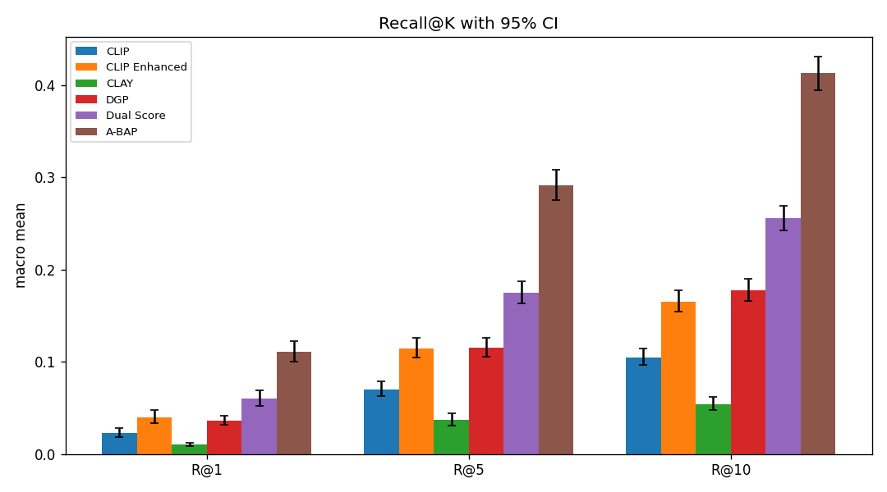

<h1 align="center">Dynamic and Hybrid Conditioning<br>for Compositional Image Retrieval</h1>

<p align="center">
  
  
  
  
  
  
</p>

---

## The problem

**Compositional image retrieval** means searching a database with a reference image plus a set of textual edits. Given a reference face $v_{ref}$, some positive constraints $T^+$ (e.g. `+Eyeglasses`) and some negative ones $T^-$ (e.g. `-Smiling`), the system must return images of someone who looks like the reference, **does** have the positive attributes and **does not** have the negative ones.

The project starts from two recent works. **GDE** (Berasi et al., CVPR 2025) decomposes entangled vision-language embeddings into separable structures, and **CLAY** (Lim et al., CVPR 2026) turns the CLIP embedding space into a text-conditional similarity space. CLAY, however, combines multiple conditions by naïvely stacking their embeddings before an SVD: a rigid, polarity-blind construction with no control over how conflicting conditions should be weighted.

**The goal was to replace that rigid stack with a fusion module Φ(v_ref, T⁺, T⁻)** that intelligently combines positive (additive) and negative (subtractive) constraints into a query able to retrieve the right targets.

### Setting and constraints

| | |
|---|---|
| Backbone | CLIP ViT-B/32 (`openai/clip-vit-base-patch32`), **frozen** |
| Retrieval database | 19,962 CelebA test images, encoded **once** offline and never modified |
| Training data | 162,770 CelebA train images (used only for mining, probes and training Φ) |
| Benchmark | 13 official queries, from single edits (`+Smiling`) to three-way compositions (`+Wearing_Lipstick & -Heavy_Makeup & +Smiling`) |
| Ground truth | A target is valid if it **strictly satisfies** every ± constraint **and** differs from the reference in **at most 2** of the remaining attributes (relaxed Hamming distance) |
| Metrics | Recall@K (hit rate, primary) and Precision@K, for K ∈ {1, 5, 10} |

---

## The approach: from geometry to probability

The project is structured as a progressive investigation, where each stage was motivated by the failures of the previous one.

### 1. Training-free methods: working in CLIP geometry

We began with the mandated baseline, plain latent arithmetic ($q = v_{ref} + \sum t^+ - \sum t^-$), and progressively corrected its geometric flaws:

- **CLIP Enhanced**: modality-gap centering (image and text embeddings live in two separate cones), delta normalization, and prompt ensembling.
- **CLAY and GDE reproductions**: faithful re-implementations of the two assigned methods. Both scored *below* vanilla arithmetic on this benchmark, empirically confirming that the pre-SVD stack is a real bottleneck.
- **GDE-VP**: geodesic composition of visual prototype directions mined on the train split, with negation implemented as *orthogonal rejection* ("not red hair" means any hair colour is fine, not "anti-red").
- **Asymmetric and union subspaces**: separate per-polarity subspaces and subspace-based negation.
- **Dynamic Gated Projection (DGP)**: a closed-form, reference-conditioned gate that directly replaces CLAY's fixed equal-weight subspace.

Every one of these methods plateaued around R@5 ≈ 0.115 and **scored exactly 0 on the pure-negation query `-Male, -Mustache`**, under every configuration.

### 2. Learned fusion modules

The gate was then made learnable. **Φ-Gate** uses cross-attention between the reference and the prompt bank, trained on synthetic queries generated with the same rule as the ground truth. Successive variants added a listwise ranking loss (ListNet), a learned negation head, online hard-negative mining and an attribute-disentanglement regularizer (**Φ-Combined**). The strongest of this family, **Dual Score**, adds calibrated attribute-probe channels next to the geometric query.

Learning improved every metric, but the negation floor remained. The conclusion: the limitation was not the fusion operator, but the scoring substrate itself — **a single vector compared by cosine similarity** cannot represent "has A, lacks B, and otherwise looks like the reference." On `-Male, -Mustache`, valid targets are the reference's *female attribute-twins*, exactly the images that CLIP cosine ranks lowest.

### 3. The probabilistic pivot: BAP and A-BAP

Since the benchmark's ground-truth rule is fully known, we stopped approximating it geometrically and **scored it directly as Bayesian inference over the 40-attribute space**.

**BAP (Bayesian Attribute-Posterior scoring).** 40 logistic probes on the frozen CLIP features turn each image into calibrated attribute probabilities (88.5% mean accuracy, trained in about ten CPU seconds). Each candidate is then scored as:

$$
S(x) = \underbrace{\sum_{a \in T^+} \log p_a(x) + \sum_{b \in T^-} \log\big(1 - p_b(x)\big)}_{\text{constraint satisfaction}}
\; + \; \underbrace{\log P\Big(\textstyle\sum_{c\,\in\,\text{free}} D_c \le 2\Big)}_{\text{identity: Poisson-binomial tail}}
$$

The identity term, computed exactly with a small dynamic program, expresses "same person, up to two different attributes" in the benchmark's own language — the ingredient no geometric method had. Reference attributes are estimated by the probes, never read from test labels.

**BAP+** adds correlation-aware refinements, each ablated individually: temperature-scaled probe calibration, a **Chow–Liu dependency tree** to handle correlated attributes (Lipstick ↔ Makeup), and a Hamming tail conditioned on the constrained assignment.

**A-BAP (Amortized BAP)** turns the closed-form score into the fusion module Φ required by the assignment. The database is augmented once, offline, with the probe channels, and Φ (a small MLP trunk with zero-initialized heads) emits **a single composite query embedding** scored by one inner product. Thanks to a **Bayes initialization**, the untrained Φ reproduces the closed-form score exactly (numerical deviation 0.0), so training, with a ListNet ranking loss, can only refine it.

---

## Results

All numbers are means over the 13 unique official CelebA queries.



### Best training-free results

| Method | R@1 | R@5 | R@10 |
|---|---|---|---|
| CLIP vanilla arithmetic (baseline) | 0.022 | 0.070 | 0.105 |
| CLAY reproduction | 0.010 | 0.037 | 0.054 |
| CLIP Enhanced | 0.040 | 0.114 | 0.165 |
| DGP — *best geometric method* | 0.036 | 0.115 | 0.178 |
| BAP (closed form) | **0.087** | 0.260 | 0.355 |
| **BAP+** — *best training-free overall* | 0.074 | **0.275** | **0.366** |

BAP and BAP+ involve no training of the fusion itself: the only fitted components are the linear attribute probes and their calibration.

### Best trained results

| Method | R@1 | R@5 | R@10 |
|---|---|---|---|
| Φ-Gate (cross-attention, InfoNCE) | 0.038 | 0.111 | 0.161 |
| Φ-Combined (best pure-geometry model) | 0.056 | 0.158 | 0.233 |
| Dual Score | 0.060 | 0.175 | 0.256 |
| **A-BAP (ListNet)** — ***champion*** | **0.110** | **0.291** | **0.413** |

The final model reaches **R@1 = 0.110, R@5 = 0.291, R@10 = 0.413**: roughly **4× the vanilla baseline** and **+61% R@10 over Dual Score**, the strongest non-probabilistic model. Under a stratified bootstrap with paired Holm–Bonferroni-corrected comparisons, **A-BAP is significantly better than every baseline on every metric** (30/30 comparisons).

### Key findings

- **The negation floor is broken.** On `-Male, -Mustache`, R@5 went from 0.000 for every geometric method to 0.222 with the closed-form BAP, with no training at all. On `+Chubby, -Young` the gain was 16×.
- **Every refinement was tested on evidence.** Calibration and the conditioned dependency tree were kept; a cosine tie-breaking channel and query-bank normalization (QB-Norm) were tested and **rejected** because they did not help, and swapping ListNet for LambdaLoss underperformed on all three seeds.
- **Custom stress queries** (nine additional queries with a ground-truth generator verified to reproduce the official one with zero mismatches) confirmed the results: A-BAP reaches R@5 0.199 versus at most 0.061 for every baseline. On a four-constraint query (`+Male, -Young, +Eyeglasses, -Smiling`), CLIP, CLIP Enhanced and CLAY score exactly 0 at every K, while A-BAP reaches 0.600 R@10.

### Cross-dataset transfer: AwA2 and OVAD

The full model roster was also evaluated on two datasets with very different attribute structures:

| Dataset | Attribute structure | Winner (R@1 / R@5 / R@10) | A-BAP |
|---|---|---|---|
| **AwA2** | 85 attributes, annotated per *class* (50 animal species) | Dual Score: 0.265 / 0.489 / 0.585 | mid-pack (0.098 / 0.225 / 0.294) |
| **OVAD** | 117 tri-state attributes per *object instance*, ~26× less training data | Dual Score: 0.084 / 0.254 / 0.412 | last at R@1 and R@5 |

This is an honest and informative result. A-BAP scores the ground-truth rule directly, which is ideal when attributes are dense, per-image and well populated (CelebA has ~4,000 images per attribute; OVAD only ~53). When that condition fails, probe errors accumulate over many free attributes and the identity term turns into noise. Methods that **keep a CLIP-cosine backbone and add learned attribute evidence on top** (Dual Score) transfer much more robustly. The overall lesson: rule-based scoring of a known generative process wins when the label space is dense, while a learned combination of geometric and semantic evidence is the safer default when it is not.

---

## Technologies

| Area | Tools |
|---|---|
| Deep learning | PyTorch, HuggingFace Transformers (CLIP ViT-B/32), torchvision |
| Geometry | Riemannian operations on the unit sphere (Karcher mean, Log/Exp maps, geodesic composition), SVD subspaces, QR-based orthogonal rejection |
| Learned fusion | Cross-attention, MLP heads with zero/Bayes initialization, ListNet and LambdaLoss ranking losses, InfoNCE, online hard-negative mining, AdamW |
| Probabilistic modelling | Logistic attribute probes, temperature scaling, Chow–Liu dependency trees with sum-product message passing, exact Poisson-binomial dynamic programming |
| Statistics | Stratified and paired bootstrap, Holm–Bonferroni correction, confidence intervals over per-source outcomes |
| Infrastructure | Google Colab and a university GPU VM, cached frozen feature tables, pytest (~130 unit tests), Matplotlib |

---

## Repository structure

```
notebooks/
├── deliverable_report.ipynb      Final report: full method, code, results and analysis
└── progressions/                 Exploratory notebooks: feature extraction, early fusion, statistics
src/
├── Baselines/                    CLIP, CLAY and GDE reproductions
├── Training-Free/                CLIP Enhanced, GDE-VP, subspace methods, DGP
├── Trained/                      Φ-Gate, Φ-Combined, Dual Score, probes, BAP / A-BAP
├── awa2/  ovad/                  Adapters, ground-truth generators and runners for the other datasets
├── eval.py  stats_eval.py        Evaluation engine and statistical analysis
└── clip_features.py  manifold.py Feature extraction and spherical geometry
Evaluation/                       Official and custom ground-truth JSON files
output/                           Per-method result CSVs, training curves and figures
test/                             Unit tests
documents/
├── DECISIONS.md                  The 15 decisions that shaped the project
├── project_specification.md      The assignment (course-provided)
├── literature/                   State-of-the-art review and reading list
├── process/                      16 design documents, in the order they were written
└── logs/                         Per-person progress logs
```

## How to run

The whole project is reproducible from **`notebooks/deliverable_report.ipynb`**, designed to run on Google Colab. A set of flags controls what gets rebuilt: by default the notebook loads cached artifacts and trained weights, and it never launches a training run unless explicitly asked to.

| Flag | Default behaviour | When set to `True` |
|---|---|---|
| `FETCH_ARTIFACT_BUNDLE` | downloads the precomputed bundle so Run-All finishes in minutes | — |
| `RETRAIN_ABAP` / `RETRAIN_COMBINED` | loads cached weights, or skips | retrains from scratch (~45 min GPU each) |
| `REBUILD_FEATURES` | loads cached CLIP features | re-encodes CelebA (~1 h GPU) |
| `RETRAIN_PROBES` / `REFIT_CALIBRATION` | loads cached probes and calibration | refits them (seconds to minutes) |

Only the official `celeba_evaluation.json` (in `Evaluation/`) is required on the default path. The raw CelebA images are needed only to rebuild features from scratch or to render the qualitative retrieval grids.

---

## How the project evolved

The final model was not the plan. The project started as a geometric fusion problem, ran into a plateau that four families of training-free methods and several learned modules could not break, and ended with a change of scoring space, from cosine geometry to Bayesian inference. **[`documents/DECISIONS.md`](documents/DECISIONS.md)** walks through the 15 decisions along the way, including the dead ends and the negative results, each linked to the document where it was made.

All the plans, theory briefs and design reports we wrote are kept in [`documents/process/`](documents/process/), unedited apart from a banner on each that says what happened next. Our progress logs are in [`documents/logs/`](documents/logs/). The [documents index](documents/README.md) also maps the working names used at the time ("Tier-2d", "Track V", "CD-Bayes"…) to the final ones.

---

## Limitations and future work

- The dependency tree only corrects **pairwise** correlations between attributes; higher-order dependencies are still unmodelled.
- The champion A-BAP configuration was trained with a **single seed**; multi-seed variance was measured only on the ablations.
- The probabilistic scorer depends on having many images per attribute, as the AwA2 and OVAD experiments show. Hybrid designs that keep a cosine identity backbone while adding the Bayesian constraint term are a natural next step.

## References

- Berasi et al. *Not only text: Exploring compositionality of visual representations in vision-language models.* CVPR 2025. (GDE)
- Lim et al. *CLAY: Conditional visual similarity modulation in vision-language embedding space.* CVPR 2026.
- Radford et al. *Learning transferable visual models from natural language supervision.* ICML 2021. (CLIP)
- Liang et al. *Mind the Gap: Understanding the modality gap in multi-modal contrastive learning.* NeurIPS 2022.
- Alhamoud et al. *Vision-language models do not understand negation.* 2025. (NegBench)
- Oldfield et al. *Parts-of-speech grounded subspaces in vision-language models.* NeurIPS 2023.
- Guo et al. *On calibration of modern neural networks.* ICML 2017.
- Chow & Liu. *Approximating discrete probability distributions with dependence trees.* IEEE Trans. Inf. Theory, 1968.
- Cao et al. *Learning to rank: from pairwise approach to listwise approach.* ICML 2007. (ListNet)
- Liu et al. *Deep learning face attributes in the wild.* ICCV 2015. (CelebA) · Xian et al., TPAMI 2018 (AwA2) · Bravo et al., CVPR 2023 (OVAD)

## Team

Alfonso Antognozzi and Davide Cabitza, June 15 – July 5, 2026. Who worked on what is recorded in the [progress logs](documents/logs/) and in the author line of each [process document](documents/README.md#process-documents).

<p align="center"><sub>Developed for the Deep Learning course, 2026.</sub></p>
